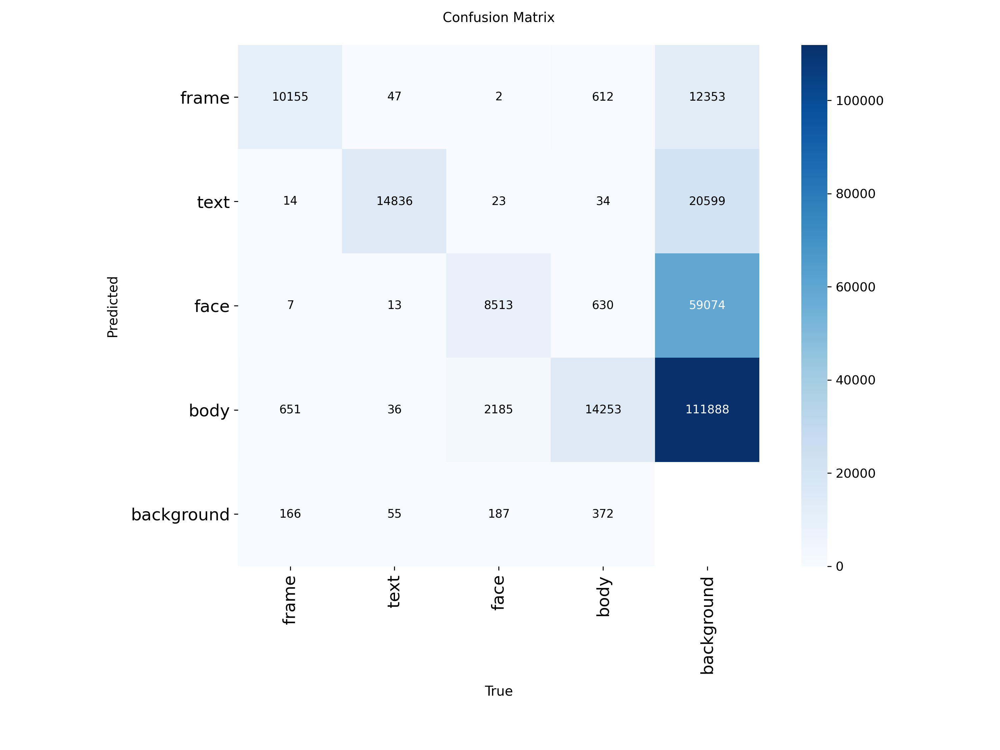
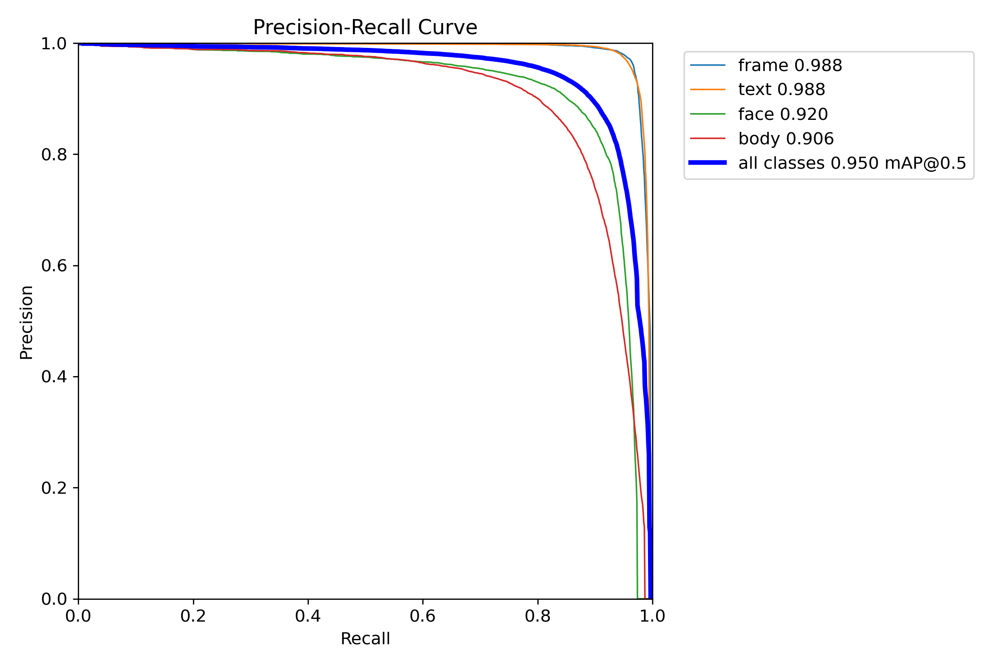

# manga-lens

Phân tích một trang manga: phát hiện **panel / text / mặt / thân**, sắp **thứ tự đọc** (phải sang trái,
có xử lý trang đôi), **OCR thoại** tiếng Nhật và **gom mặt/thân theo nhân vật** trong một chương. Dự án cá nhân
để luyện thị giác máy tính. Dữ liệu: [Manga109](http://www.manga109.org/) (chỉ dùng cho học thuật). Chưa gán lời
thoại cho nhân vật nói (speaker attribution).

```
ảnh trang -> YOLO11s (frame/text/face/body) -> XY-cut (panel, rồi thoại trong panel) -> manga-ocr -> JSON + ảnh vẽ
                                            \-> DINOv2 re-ID (face/body) -> gom cụm -> "nhân vật 1, 2, 3..."
```

## Kết quả

Tất cả số liệu đo trên các bộ truyện **tập test** (chia theo bộ truyện, không chia theo trang, để tránh rò
rỉ nhân vật/nét vẽ). Huấn luyện: `yolo11s`, 50 epoch, imgsz 1024, batch 16, một GPU T4 (Kaggle).

### 1. Detector (1220 ảnh test)

| Lớp | mAP50 | mAP50-95 |
|---|---|---|
| frame (panel) | 0.993 | 0.970 |
| text (chữ) | 0.990 | 0.889 |
| face | 0.896 | 0.457 |
| body | 0.920 | 0.690 |
| **Tất cả** | **0.949** | **0.752** |

Precision 0.930, recall 0.904. Suy luận trên T4, imgsz 1024: 15.8 ms (mạng) + 1.9 (tiền xử lý) + 3.7
(hậu xử lý) mỗi ảnh. mAP50-95 test (0.752) khớp val (0.746), nên không có dấu hiệu overfit.
`face` và `body` thấp ở mAP50-95: model tìm được nhưng box không khít (nhãn không nhất quán, mặt nhỏ,
thân bị che).

| Ma trận nhầm lẫn (tập val) | Đường precision-recall (tập val) |
|---|---|
|  |  |

*Hai biểu đồ đo trên tập **val** ở ngưỡng conf rất thấp (0.001), nên cột "background" bị thổi lên và
không phản ánh hoạt động ở conf 0.25.*

### 2. OCR (manga-ocr, 200 trang test ngẫu nhiên, 2987 text box)

| Nhóm | CER theo box | Đúng hoàn toàn |
|---|---|---|
| Box GT (giới hạn trên của OCR) | 0.034 (0.039 theo ký tự) | 84.3% |
| Box dự đoán (ghép được với GT, IoU ≥ 0.5) | 0.027 | 84.4% |
| **End-to-end** (GT bị detector sót tính CER 1.0) | **0.055** | 82.1% |

Detector bắt được 97.2% text (conf 0.25), 125 box thừa trên 3028 box dự đoán.
`manga-ocr` luôn xuất ký tự toàn chiều rộng (`．`, `！`) còn nhãn dùng `…`, `・`: nếu so từng ký tự, CER
là 0.156, nhưng phần lớn là khác cách viết dấu câu. Mặc định script chuẩn hóa dấu câu
(`--strict` để so từng ký tự).

### 3. Thứ tự đọc (30 trang tự gán nhãn, đọc trang phải trước)

| Panel \| text | Kendall tau | Trang đúng hoàn toàn |
|---|---|---|
| GT \| GT | 0.991 | 28/30 |
| **dự đoán \| dự đoán (pipeline thật)** | **0.991** | **29/30** |
| XY-cut thẳng trên text, không dùng panel | 0.942 | 19/30 |
| baseline: trên xuống, phải sang trái | 0.410 | 0/30 |

Ba điểm mấu chốt: (1) **tách trang đôi** là bắt buộc (tắt đi, tau còn 0.606); (2) viền panel thật hay chồng/lệch
nhau 30-60 px nên dung sai XY-cut mặc định 1% không cắt được: dung sai riêng `panel_tol = 0.05` cho panel đưa tỉ lệ
trang đúng từ 20/30 lên 28/30 (box GT); (3) khi panel chồng lấn hẳn và không có đường cắt sạch, phương án dự phòng
sắp theo **cạnh trên rồi phải sang trái** (thay vì tâm y) đọc đúng hơn: tau 0.986 lên 0.991, panel 15/16 lên 16/16.
Trên một chương truyện thật không có nhãn, detector hay trả các panel chồng lên nhau, và phương án dự phòng mới giảm số
cặp thoại bị đọc ngược chiều từ 12 xuống 4 (chỉ số gián tiếp, chưa có nhãn thật).

### 4. Gom nhân vật (re-ID, trong MỘT bộ truyện)

Nhãn nhân vật lấy từ XML Manga109 (thuộc tính `character` của mỗi mặt/thân; id chỉ có nghĩa trong từng bộ nên chỉ
đo được gom **trong một bộ**, không nhận dạng xuyên bộ). Mô hình: DINOv2-small fine-tune bằng SupCon trên 87 bộ train,
chọn trên 11 bộ val, đo trên 11 bộ test. Gom bằng agglomerative (average-linkage, cosine), ngưỡng cắt chọn trên val.
Bỏ nhân vật nền "Other"; chỉ xét nhân vật có ≥ 2 box. Số trung bình theo bộ; xáo nhãn ngẫu nhiên cho BCubed F1 ≈ 0.20.

| Test, 11 bộ | Face | Body |
|---|---|---|
| DINOv2 thô, box GT: BCubed F1 / ARI | 0.395 / 0.131 | 0.336 / 0.030 |
| **Fine-tune, box GT**: BCubed F1 / ARI / Recall@1 | **0.636** / 0.554 / 0.842 | **0.549** / 0.430 / 0.766 |
| Fine-tune, **box detector dự đoán** (end-to-end, tính box thừa và mặt sót) | **0.590** / ARI 0.472 | **0.526** / ARI 0.421 |
| Recall / precision của detector | 86% / 88% | 90% / 86% |

Fine-tune đưa BCubed F1 của face từ 0.395 lên 0.636 (box GT), và giữ ở 0.590 khi dùng box do detector dự đoán.
Ghép face + body bằng khoảng cách đặt tay hay MLP học trên val cải thiện ARI/pairwise F1 (ARI 0.47-0.49 so với 0.386 của chỉ-face)
nhưng **không vượt chỉ-face theo BCubed F1** (0.57-0.59 so với 0.593, chênh nằm trong sai số): ghép chỉ rõ ràng có ích ở
bộ mà detector bắt mặt kém. Khuyến nghị gom theo mặt; `--mode fused` để bù trang không bắt được mặt.

### 5. Chuỗi cả pipeline (ước lượng)
detector tìm ~98% text → thứ tự thoại đúng ở 29/30 trang → OCR sai ~3-4% ký tự trên box đúng.

## Phân tích lỗi

- **Detector bỏ sót text (84/2987 box):** 52% chỉ có conf thấp (0.01-0.25), 23% bị gộp (Manga109 chia box theo
  cột, detector gộp nhiều cột thành một), 15% hoàn toàn không thấy (0.4% tổng). Hạ ngưỡng conf (0.15) thu về
  13 box nhưng thêm 54 box thừa; nhận thêm box conf thấp ở "chỗ trống" cho 27 box đúng và 129 box thừa. Cả hai
  đều không đáng, nên giữ conf 0.25.
- **OCR:** lỗi thật tập trung ở (i) chú thích dài trên box rất hẹp và dài (CER 0.8-0.9), (ii) ảo giác chữ trên box
  chỉ có dấu chấm, (iii) chữ viết tay / cách điệu / SFX, (iv) nhiều dòng và chữ lặp, (v) vài nhãn GT nghi nhiễu.
- **Thứ tự đọc:** trang sai duy nhất là layout lệch hàng mà người gán nhãn đọc theo cột (nhập nhằng).
- **Gom nhân vật:** vẫn chia thừa cụm (~1.4 lần số nhân vật thật ở box GT) và khác nhau nhiều giữa các bộ (BCubed F1 face
  0.42-0.81, thấp nhất ở bộ nhiều nhân vật: Hamlet, HeiseiJimen, WarewareHaOniDearu). Bộ detector bắt ít mặt (Akuhamu, recall
  61%) tụt từ 0.62 (box GT) xuống 0.49 (box dự đoán). Riêng MiraiSan lại gộp thừa, nên một ngưỡng cố định không tối ưu cho mọi bộ.

## Giới hạn

- Mẫu nhỏ: OCR 200 trang, thứ tự đọc 30 trang. Các số liệu thứ tự đọc được chọn tham số (`panel_tol`) trên chính
  các trang này nên hơi lạc quan (leave-one-title-out: 28/30, không có dấu hiệu overfit rõ).
- Thứ tự đọc chỉ tính trên text ghép được với GT; text bị sót và box thừa không nằm trong tau.
- Chỉ thử một model (`yolo11s`); chưa có bảng so sánh `yolo11n/m`, `rtdetr-l`. Chưa làm mask bong bóng (SAM).
- Gom nhân vật chỉ đo trên 11 bộ test và chưa có nhãn truyện thật để chấm; số val và test lệch nhau (cùng cấu hình, hai tập
  khác độ khó), ngưỡng cắt chọn bằng lưới thô trên val và có thể không còn tối ưu trên chương mới. Chưa gán thoại cho nhân vật.
- Mới chạy demo trên máy cá nhân; chưa đưa lên Hugging Face Spaces.

## Chạy lại

```bash
pip install -r requirements.txt
python tests/test_basic.py                       # kiểm tra nhanh, không cần dữ liệu

# Dữ liệu: xin Manga109 tại manga109.org (học thuật), giải nén, rồi:
python scripts/convert_manga109.py --root /path/Manga109 --out data/yolo --copy

# Train: notebook kaggle_train.ipynb (tải Manga109 từ Hugging Face rồi train trên Kaggle), hoặc local:
python scripts/train.py --model yolo11s.pt --epochs 50 --imgsz 1024 --batch 16

# Đánh giá
python scripts/eval_det.py --weights weights/best.pt
python scripts/eval_ocr.py --root /path/Manga109 --titles data/yolo/test_titles.txt --weights weights/best.pt
python scripts/eval_order_pred.py --root /path/Manga109 --weights weights/best.pt   # cần nhãn thứ tự đọc

# Nhận dạng nhân vật: nhãn -> fine-tune (Kaggle, notebook kaggle_reid.ipynb) -> đo
python scripts/extract_characters.py --root /path/Manga109
python scripts/eval_cluster_pred.py --cls face --tag f_b --weights-reid data/reid/f_b/best.pt --root /path/Manga109

# Gom nhân vật trên một chương (ảnh / thư mục / .cbz); xem số cụm theo ngưỡng trước rồi chạy thật
python scripts/run_characters.py "chuong1" --sweep 0.3 0.4 0.5 0.6
python scripts/run_characters.py "chuong1" --thr 0.5 --draw

# Demo Gradio
python app.py --weights weights/best.pt
```

Tự gán nhãn thứ tự đọc: `python scripts/label_order.py --root /path/Manga109` (bấm box thoại theo thứ tự đọc),
rồi `python scripts/eval_order.py --mode text`.

## Cấu trúc

| Đường dẫn | Việc |
|---|---|
| `src/pipeline.py`, `app.py` | pipeline end-to-end, demo Gradio |
| `src/reading_order.py` | XY-cut đệ quy phải→trái, tách trang đôi, gán text vào panel, Kendall tau |
| `src/ocr.py` | manga-ocr, CER, ghép box, chẩn đoán box bị sót |
| `scripts/` | convert, train, các script đánh giá, công cụ gán nhãn thứ tự đọc |
| `scripts/extract_characters.py`, `train_reid.py`, `eval_cluster*.py`, `eval_fused*.py`, `run_characters.py` | nhận dạng nhân vật: nhãn, fine-tune, đo, ghép face+body, chạy trên chương |
| `kaggle_train.ipynb` | train detector trên Kaggle |
| `kaggle_reid.ipynb` | fine-tune re-ID (face/body) trên Kaggle, Run All một lần |

## Lưu ý

- Luôn chia train/val/test **theo bộ truyện**. Không bật lật ngang (`fliplr`) khi train: lật làm sai hướng đọc.
- Repo chỉ chứa code, tài liệu và biểu đồ số liệu. Không commit ảnh/dataset/trọng số, không đăng trang truyện
  có bản quyền (README, demo) và tuân thủ điều khoản của Manga109.
